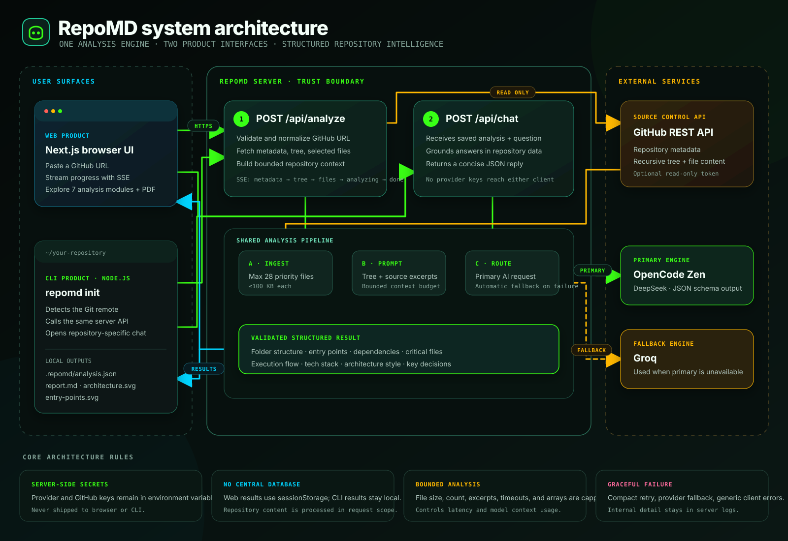

# RepoMD

RepoMD has two interfaces backed by the same repository-analysis API:

- `web/` — the browser interface and shared AI API, with OpenCode Zen as the primary provider and Groq as fallback.
- `cli/` — the terminal interface for repository analysis, SVG exports, and chat.



Open the standalone [architecture presentation](architecture.html) for an interactive, fullscreen judge briefing. The complete [architecture explanation](explanation.md) provides the presentation narrative, API flow, operating rules, security boundaries, tech stack, limits, and tradeoffs.

## Run locally

Start the web service:

```bash
cd web
pnpm dev
```

The personal CLI is linked as `repomd` on this machine. From a GitHub repository, run:

```bash
repomd init
```

RepoMD detects the `origin` GitHub remote, analyzes it through the web service, creates `.repomd/architecture.svg` and `.repomd/entry-points.svg`, and opens repository chat. Later sessions can use:

```bash
repomd
# or
repomd chat
```

The CLI defaults to `http://localhost:3000`. Set `REPOMD_API_URL` when using a different deployment.

Provider keys stay on the web server. The CLI automatically uses the same OpenCode-first, Groq-fallback routing through that API and does not need its own AI key.
